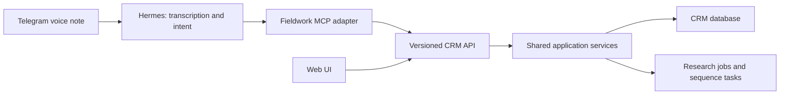

# Agent access proposal

Implementation update: the standalone [Fieldwork app](../../apps/fieldwork/README.md) now implements server persistence, authenticated API operations, audit history, research job claims, and a working stdio MCP adapter. The proposal below is retained as design history; see the app README and live API schema for current behavior. Its backend uses Node.js and SQLite, with no local PHP runtime required.

Status: design proposal. The current UI is a browser-local prototype. It has no live REST write API, MCP server, Telegram bot, or Hermes connection. The static Node server only serves files. Research operations are isolated in `research-model.js` so their validation and behavior can be carried into a shared service.

## One application, several interfaces

Use a separate Laravel application and database for the eventual CRM. Both the web UI and agents should call the same application services for record creation, stage changes, research findings, and sequence transitions. Preserve stable record IDs and use separate serializers for the public API. Browser-local state must be imported into this backend before agents can share it.

The API is the durable integration surface. MCP offers named, typed tools for Hermes or another agent and delegates to the same API; it does not own a second database or bypass application rules. For Hermes on the same server, a local stdio MCP adapter can access the private CRM API. Remote agents can use an authenticated HTTP MCP service when needed. Keep the web UI/API separately authenticated and reachable only on the intended network.

Hermes already documents [Telegram voice memo transcription](https://hermes-agent.nousresearch.com/docs/user-guide/messaging/telegram#voice-messages) and [local stdio and remote HTTP MCP support](https://hermes-agent.nousresearch.com/docs/user-guide/features/mcp). Provider choice, gateway setup, tool availability, and deployment still need configuration; these capabilities have not been verified in the user's Hermes installation.

## Research structure

- **Research investigation:** title, question/objective, status, timestamps, and later a job state. One investigation can have many subjects and run alongside many others.
- **Company/person:** reusable identity records. A company can exist without a contact or sales opportunity. A person can belong to a company. Keep research participation separate from pipeline membership.
- **Research subject:** attaches a company/person to an investigation with its context and profile/website links. The prototype uses embedded subjects; normalize identities and memberships in the backend so one person/company can participate in several investigations without duplicate profiles.
- **Finding:** subject or investigation reference, text, kind (observation/hypothesis/question), evidence link, capture time, actor, and later source publication time and review state. Keep inferred claims visibly distinct from observations. An observation label does not imply independent verification.
- **Opportunity:** eventual pipeline item, possibly tied to several people and one company. The prototype currently places people in stages; add opportunities once the user's sales unit is clearer.
- **Action/sequence enrollment:** dated next action, enrollment snapshot, status, and transition history. The server performs sequence advancement atomically so a UI click and agent retry cannot schedule two next steps.

Keep a research subject in research until the user or an authorized agent explicitly adds it to the pipeline. Link an existing identity when available. Never merge ambiguous people based only on their name.

## Proposed API and tool map

These endpoints and tools are contracts to implement, not working URLs. Collections support search, filters, cursor pagination, stable IDs, and updated-since queries. Single-resource responses include a version; mutations use expected versions to detect concurrent edits.

| Operation                            | REST under `/api/v1`                                                           | MCP tool                                                                  |
| ------------------------------------ | ------------------------------------------------------------------------------ | ------------------------------------------------------------------------- |
| Search identities and investigations | `GET /search?q=…&types=people,companies,research`                              | `search_records`                                                          |
| Create/read/update a person          | `POST /people`, `GET/PATCH /people/{id}`                                       | `create_person`, `get_person`, `update_person`                            |
| Create/read/update a company         | `POST /companies`, `GET/PATCH /companies/{id}`                                 | `create_company`, `get_company`, `update_company`                         |
| Add a note or profile link           | `POST /people/{id}/notes`, `POST /people/{id}/links` (and company equivalents) | `add_note`, `add_profile_link`                                            |
| List stages; move a pipeline item    | `GET /pipelines/{id}/stages`, `POST /pipeline-items/{id}/transitions`          | `list_pipeline_stages`, `move_pipeline_item`                              |
| Create/read/update an investigation  | `POST /research`, `GET/PATCH /research/{id}`                                   | `create_research`, `get_research`, `update_research`                      |
| Attach a research subject            | `POST /research/{id}/subjects`                                                 | `add_research_subject`                                                    |
| Add a sourced finding                | `POST /research/{id}/findings`                                                 | `add_research_finding`                                                    |
| Promote a subject into a pipeline    | `POST /research/{id}/subjects/{subjectId}/promotions`                          | `promote_research_subject`                                                |
| Start/check background research      | `POST /research/{id}/jobs`, `GET /jobs/{id}`                                   | `start_research_job`, `get_job`                                           |
| List/create/complete actions         | `GET/POST /actions`, `POST /actions/{id}/completions`                          | `list_actions`, `create_action`, `complete_action`                        |
| Enroll/pause/resume/record reply     | `POST /sequence-enrollments`, `POST /sequence-enrollments/{id}/events`         | `enroll_in_sequence`, `pause_sequence`, `resume_sequence`, `record_reply` |

For write calls, carry an idempotency key based on the Telegram update and operation number, so replayed messages or retries do not duplicate records. The backend stores the key, payload hash, and result together with the transaction. A mismatched reuse returns a conflict. Authenticate a dedicated agent identity with scoped permissions; derive the audit actor from the credential rather than trusting an `author` supplied by the model. Record request IDs, changed fields, source references, and operation results.

Return typed errors (`ambiguous_match`, `version_conflict`, `validation_failed`, `permission_denied`) with useful next actions. Resolve exact IDs before changing stages or notes. A speech-to-text name like “Maya” can produce several matches; the agent should ask which person and continue independent research if appropriate. Resolve relative dates in `America/Mexico_City` and confirm the actual date in the result.

## Example voice note

“Start a research on independent studios. Add Lumen Studio and Sofia Rivera, save their profiles, and note that expanding their team might be a priority.”

1. Hermes transcribes the note and searches for the investigation, company, and person.
2. It creates or reuses exact identities, attaches them to the investigation, and stores profile links the user provided or that research actually found.
3. It records the expansion statement as a hypothesis unless evidence supports it, preserving the voice note/message reference as its origin.
4. It replies with the records it changed, links to their workspace pages, and any unresolved identities or claims.

A subsequent “Move Sofia to contacted and remind me Friday” resolves Sofia's ID and the pipeline's actual stage IDs, records a transition, and adds a dated action. It never treats a stage change as proof that a message was sent.

## Long-running research

Separate an investigation's workflow status (Exploring/Waiting/Ready/Archived) from execution status (queued/running/completed/failed/cancelled). A research job carries its brief, subject IDs, initiating actor, progress, last update, and findings. Return a job ID immediately, let a queue run parallel jobs with a concurrency limit, and publish findings as they arrive. Hermes can either run the research externally and post findings or ask a dedicated research worker to run it. Choose one executor per job to prevent duplicate work.

Start with authenticated reads plus record/notes/findings/actions writes. External outreach is a separate integration with its own rules and delivery receipts. Source pages and scraped text are evidence, not instructions authorizing CRM changes. Show agent edits in the same activity history as human edits. A Telegram owner allowlist and narrowly scoped agent credential establish who may perform the requested operations.

## Next implementation milestone

1. Create the separate backend with persistent storage, authentication, the API schema, idempotency, and audit history; import the exported prototype workspace once.
2. Connect the UI to its API and implement the listed CRUD and workflow transitions.
3. Add a small MCP adapter and verify the core tools against the same application services.
4. Connect the user's Hermes gateway and Telegram identity; test a voice note through create → finding → stage move → next action.
5. Add queued research and notification delivery once the basic round trip works.
